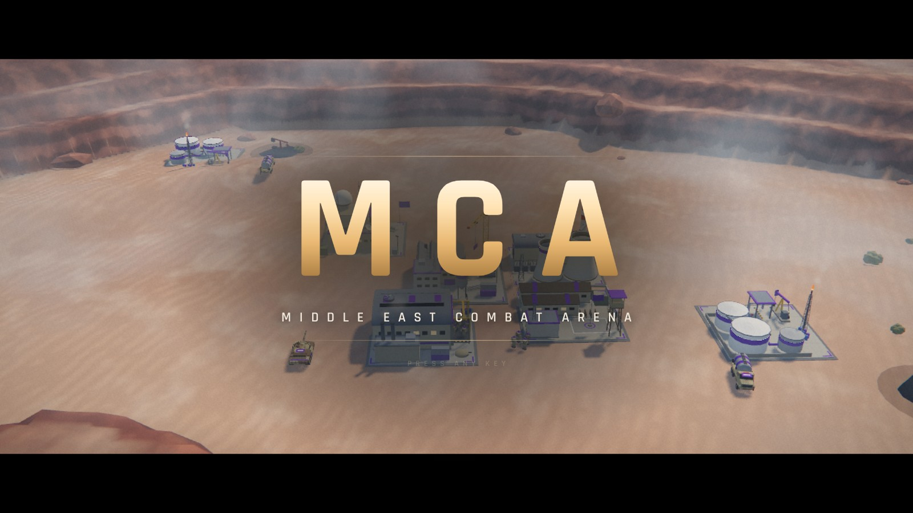
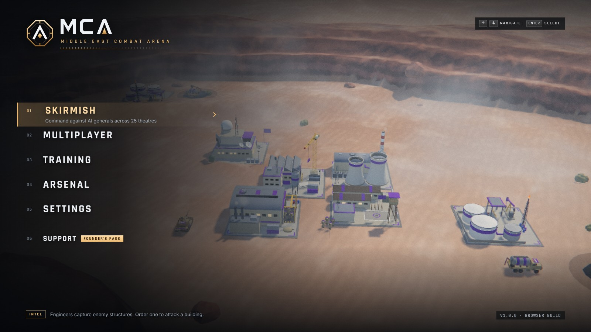
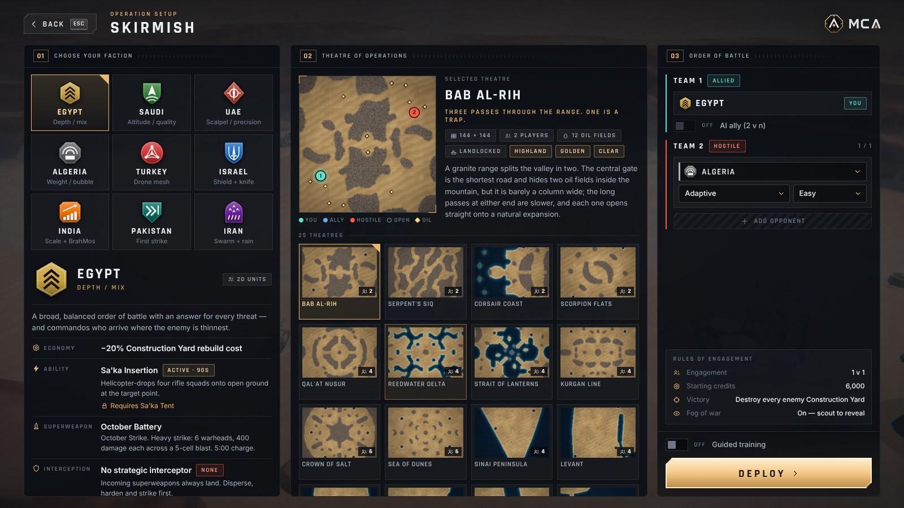
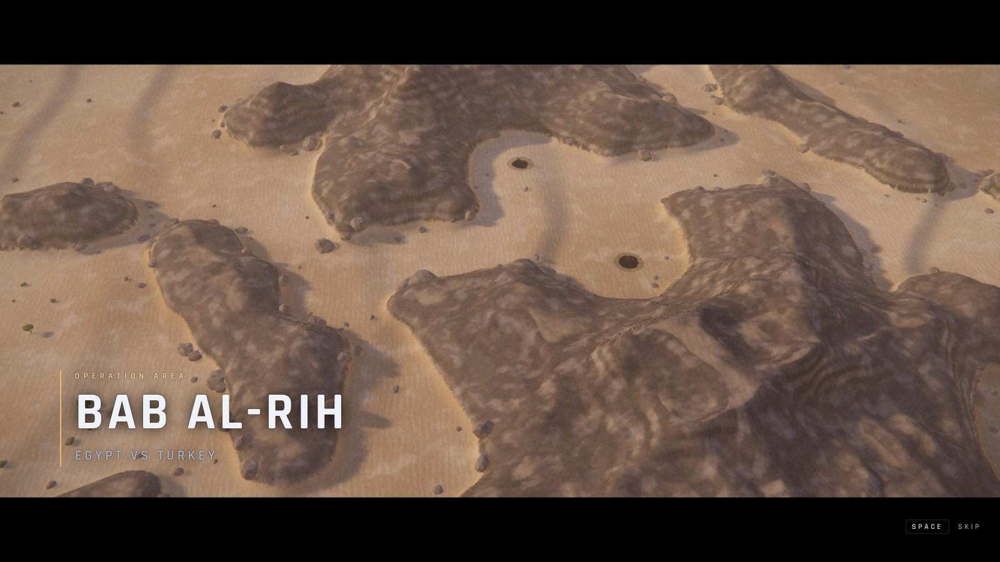
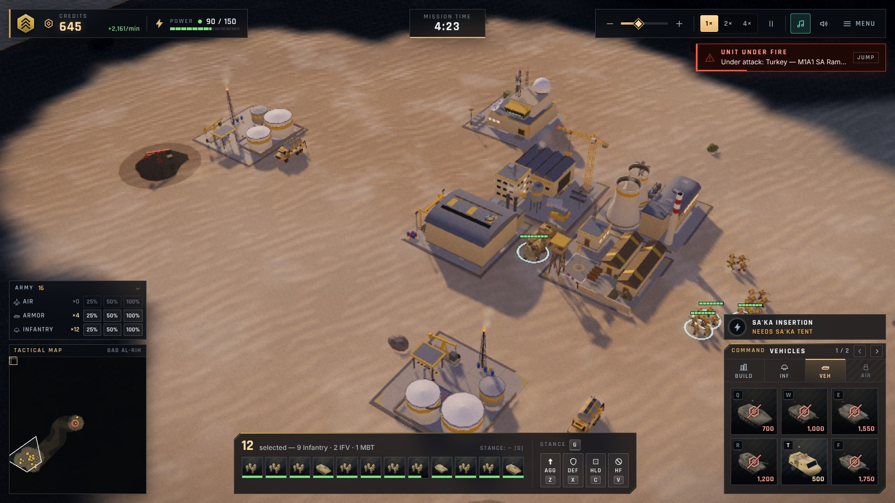
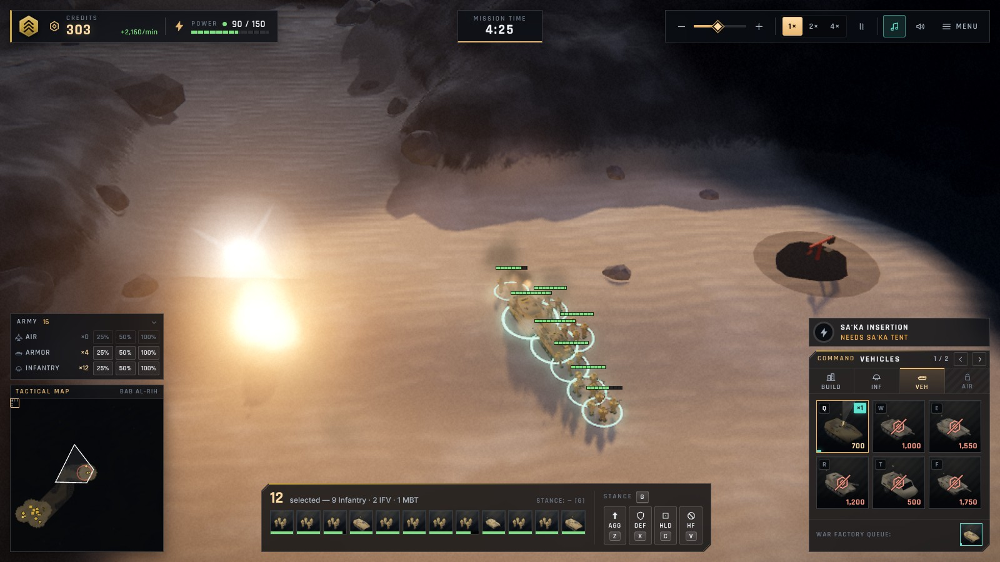
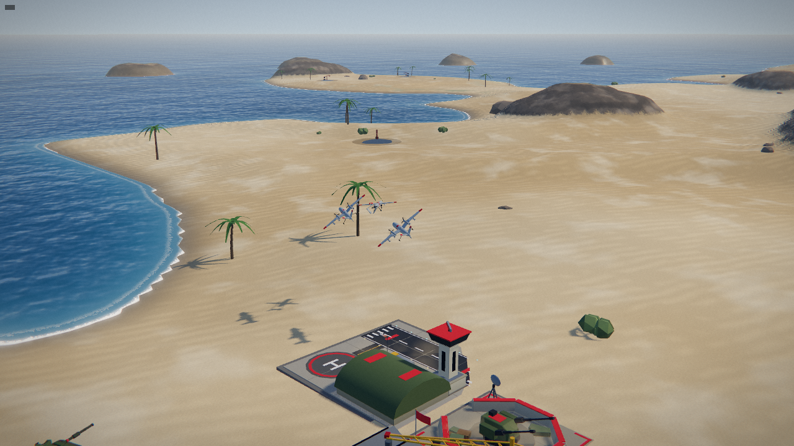

# MCA — Middle East Combat Arena

A real-time strategy game that runs entirely in the browser. Nine factions, 161 units, 35 structures, land / air / naval combat, skirmish against AI and online multiplayer — rendered in real time with a modern WebGL2 pipeline and almost no shipped assets: every model, texture, sound effect and note of music is generated by code. The one exception is speech — the announcer and unit radio lines are short pre-rendered clips, produced offline by `tools/voicegen`.

| | |
| --- | --- |
|  |  |
|  |  |
|  |  |



Screenshots are captured from the running game in headless Chromium with software rendering.

## Play

**Windows:** double-click `START_GAME.bat`. It installs dependencies on the first run, builds the game, starts the local server and opens `http://localhost:8790/` in your browser. It needs [Node.js](https://nodejs.org) 20 or newer.

**Any platform, for development:**

```bash
npm install
npm run dev
```

Open the URL Vite prints (default `http://127.0.0.1:5173/`).

Production build + the bundled server (static hosting and the multiplayer relay on one port):

```bash
npm run build
npm start
```

Then open `http://127.0.0.1:8790/`. Hosting it for other people is covered in [docs/ONLINE.md](docs/ONLINE.md).

## What is in the box

**Game**

- 9 factions (Egypt, Saudi Arabia, UAE, Algeria, Turkey, Israel, India, Pakistan, Iran), each with its own roster, economic perk, faction ability, superweapon and interception doctrine.
- 161 units across 21 classes with a class/counter matrix, veterancy, transports, limited air ammunition with return-to-rearm, combat air patrols, engineers that capture and repair.
- 35 structures: power, oil economy, production, tech, base defences, faction SAM batteries, superweapons, research kits.
- Skirmish against AI (several personalities and difficulty tiers), a guided tutorial, and an Arsenal browser for every unit and structure.
- An optional peace timer (off, 3, 5, 10 or 15 minutes) for skirmish and online matches: nobody can attack until it runs out. Allies share sight, on the battlefield and on the minimap.
- Online multiplayer for up to 6 players: deterministic lockstep over a small WebSocket relay with explicit end-of-input markers (latency up to the input delay is absorbed without slowing the match), desync detection, tick-aligned AI takeover when a player drops, a background pump so alt-tabbing does not stall the room, in-match chat.

**Presentation**

- WebGL2 renderer (three.js): HDR pipeline with MSAA, filmic tone mapping, bloom, colour grading; sun shadows fitted to the view; image-based lighting from the procedural sky.
- Terrain is built from each map's grid into a smooth heightfield — dune fields with slip faces, mesas, mountain ranges, beaches and shelving seabeds — with a procedural PBR material. Animated sea with depth colour, sun glints and shoreline foam.
- Eight biomes × five times of day × three weather settings; every map carries its own theme.
- Procedurally built models for every unit and structure, with faction camouflage and player colours.
- One-draw-call GPU particle system for muzzle flashes, tracers, missile trails, explosions, dust, wakes and smoke; ground decals; flash lighting; camera shake.
- Fog of war, cloud shadows and aerial perspective applied in a single depth-reconstruction pass.
- In-engine cinematics: a title sequence and menu backdrop filmed live from an AI-versus-AI battle, a flyover intro for every match, and a victory / defeat outro.
- Unit and structure portraits in the HUD are rendered from the same 3D models.
- Adaptive synthesised score and layered sound effects (Web Audio), with positional mixing.
- Spoken announcer lines and unit radio acknowledgements (pre-rendered neural-TTS clips).
- Four quality presets (Low → Ultra) and automatic resolution scaling.

## Controls

| Action | Input |
| --- | --- |
| Select / box-select | Left click / left drag |
| Move, attack, context order | Right click |
| Orbit camera | Right drag |
| Zoom | Mouse wheel |
| Pan camera | Arrow keys, resting the pointer on a screen edge, middle drag, or click the minimap |
| Deploy MCV | `D` or double-click the MCV |
| Production hotkeys | `Q` `W` `E` `R` `T` `F` |
| Control groups | `Ctrl`+`1…9` to set, `1…9` to recall |
| Select a share of a branch | The Army panel above the minimap: 25 / 50 / 100 % of air, armour, infantry or naval units |
| Select all of a type on screen | Double-click a unit |
| Show all health bars | Hold `Alt` |
| Skip a cinematic | `Space` |

The in-game Settings screen lists every hotkey.

## Repository layout

| Path | What it is |
| --- | --- |
| `client/src/sim/` | The deterministic simulation: integer 10 Hz ticks, seeded RNG, checksums. It has no rendering or DOM dependencies and runs unchanged in Node. |
| `client/src/gfx/` | The renderer: terrain, water, sky, post-processing, effects, entity animation, portraits, and the procedural model library. |
| `client/src/game/` | HUD, menus, input, minimap, cinematics, audio front-end. |
| `client/src/audio/` | The synthesis engine: instruments, score, sound effects; and the voice clip player. |
| `client/public/voice/` | Pre-rendered voice clips and their manifest (generated, see `tools/voicegen/`). |
| `client/src/net/` | Lockstep scheduler and relay client. |
| `client/data/game.json` | Every unit, structure, faction and upgrade definition. |
| `client/maps/` | Maps (terrain grid, oil, spawns, theme) and the manifest. |
| `server/` | Node server: static hosting, WebSocket relay, optional payments and licence keys. |
| `tools/mapgen/` | Map generator, validator and preview renderer. |
| `tools/voicegen/` | Offline voice pipeline: line table, TTS rendering, processing, loudness checks. |
| `docs/` | Hosting, monetisation and design documents. |

## Tests

```bash
npm test
```

Runs three suites:

- `npm run test:sim` — the simulation: determinism, combat maths, economy, power, tech gating, superweapon interception, elimination, AI smoke match, the opening ceasefire.
- `npm run test:maps` — every map in the manifest: schema, deployability, economy reachable by the AI, land and sea paths, fairness on the generated maps, and an AI-versus-AI smoke match.
- `npm run test:server` — relay protocol, static hosting, licence and payment flows against a local Stripe mock, and headless multi-peer lockstep matches through the real relay (frozen peers, dropped players with commands in flight, slow starters).

## Developer pages

- `/lab.html` — renderer lab: boots the real simulation with AI players and no HUD. Useful query parameters: `map`, `ticks` (fast-forward), `tod`, `biome`, `weather`, `q` (quality), `reveal=1`.
- `/model_lab.html` — browse every procedural unit and structure model.
- `/audio_lab.html` — audition every sound effect, music track and voice clip.

## Online play and selling the game

- [docs/ONLINE.md](docs/ONLINE.md) — running the server, deploying it (Docker, Render, Fly), or hosting the client statically and pointing it at a relay.
- [docs/MONETIZATION.md](docs/MONETIZATION.md) — the built-in Founder's Pass flow (Stripe Checkout + signed licence keys), paywall modes, and what you need to supply before taking money.

## Earlier builds

`dist/MCA-Argon.html` and `dist/MCA_Reference.html` are single-file builds from earlier iterations of the project, kept for reference. The Python scripts under `tools/` belong to that earlier 2D pipeline.
